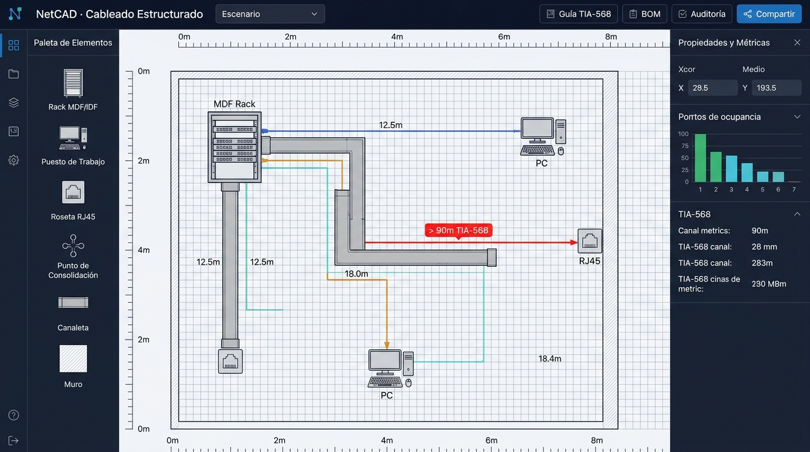
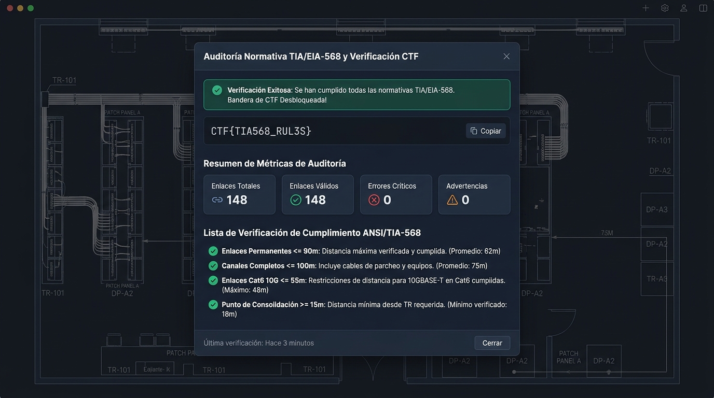
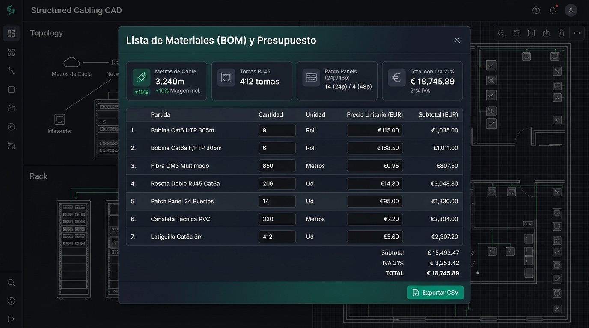

<div align="center">
  <a href="https://www.unfantasmaenelsistema.com/" target="_blank" rel="noopener noreferrer">
    
  </a>
  <h1>NetCAD · Simulador de Cableado Estructurado</h1>
  <p>
    <strong>Entorno CAD educativo 100% cliente (Zero-Backend) para diseño de planos de red, trazado ortogonal, auditoría normativa ANSI/TIA-568, presupuesto BOM y retos CTF.</strong>
  </p>
  <p>
    <a href="https://www.unfantasmaenelsistema.com/"></a>
    
    
    
  </p>
</div>

---

## Descripción General

**NetCAD · Cableado Estructurado** es un simulador interactivo de arquitectura de redes orientado a estudiantes de FP, certificaciones de redes, ingenieros de sistemas y academias técnicas. Permite diseñar planos de planta sobre una cuadrícula milimetrada real (`1 celda = 1.00 m`), dibujar canaletas ortogonales a 90°, tender enlaces de cobre o fibra óptica con ajuste magnético (*snap*), validar automáticamente el cumplimiento de la norma **ANSI/TIA-568** y generar una **Lista de Materiales (BOM)** exportable a CSV sin depender de ningún servidor.

Desarrollado para funcionar íntegramente en el navegador y desplegarse de forma estática en **GitHub Pages**.

---

## Capturas de Pantalla

### 1. Editor CAD de Planta y Trazado con Snap a Canaletas
> Interfaz estilo IDE profesional con paleta de elementos, plano milimetrado con reglas métricas dinámicas, símbolos vectoriales en planta, trazado por categorías (`Cat5e`, `Cat6`, `Cat6a`, `OM3/OM4`) y panel de propiedades con ocupación de puertos del Rack.



### 2. Auditoría Normativa TIA/EIA-568 y Retos CTF
> Motor de diagnóstico que detecta enlaces permanentes > 90 m, canales totales > 100 m, cuellos de botella de velocidad/atenuación y verifica objetivos de laboratorio desbloqueando una **Flag CTF**.



### 3. Lista de Materiales (BOM), Precios Editables y Exportación CSV
> Inventario automático con +10% de margen de desperdicio en bobinas de 305 m, cálculo de Patch Panels de 24/48 puertos, tomas RJ45, canaletas, latiguillos e IVA (21%), exportable a CSV en cliente.



---

## Funcionalidades Principales

### Diseño CAD y Topología (Fase 1)
- **Paleta de Elementos**: Racks `MDF` (42U / 48 puertos) e `IDF` (24U / 24 puertos), Puestos de Trabajo (`PC`), Tomas/Rosetas `RJ45`, Puntos de Consolidación (`CP`), Canaletas y Muros estructurales.
- **Drag & Drop y Edición Precisa**: Arrastra componentes al lienzo con ajuste opcional a rejilla de `0.25 m`, rota a 90°/45°, redimensiona muros/canaletas e inspecciona coordenadas métricas `X/Y` y ocupación de puertos en el Rack.
- **Historial y Exportación Vectorial**: Deshacer / Rehacer (`Ctrl+Z` / `Ctrl+Y`) y exportación del plano completo a **SVG vectorial**, además de guardar/cargar topologías en **JSON**.

### Motor de Trazado y Categorías de Medios (Fase 2)
- **Herramienta de Canaletas 90° (`T`)**: Dibujo poligonal estrictamente ortogonal con acotación en tiempo real por segmento.
- **Tendido Inteligente con Snap (`C`)**: Al acercar el cursor a una canaleta existente, el cable se acopla magnéticamente (`Snap`) siguiendo automáticamente las esquinas de la bandeja.
- **Tipos de Medios Diferenciados**:
  - `Cat5e` (Gris · hasta 1 Gbps)
  - `Cat6` (Azul · 10 Gbps hasta 55 m / 1 Gbps hasta 90 m)
  - `Cat6a` (Amarillo/Ámbar · 10 Gbps hasta 90 m de enlace permanente / 100 m canal)
  - `Fibra Óptica OM3/OM4` (Aguamarina · Backbone 10 Gbps hasta 300–400 m)

### Motor Educativo ANSI/TIA-568 y Guía Técnica (Fase 3 + Mejoras)
- **Regla de los 90 Metros (Enlace Permanente)**: Cualquier enlace horizontal en cobre que supere los `90.0 m` parpadea en rojo en el plano y muestra la alerta `¡Violación de Norma: Enlace Permanente > 90m!`.
- **Cálculo de Canal Completo (≤ 100 m)**: Campos configurables para latiguillos (*Patch Cords*) en Área de Trabajo (`WA`) y Cuarto de Telecomunicaciones (`TR`), comprobando `Enlace + WA + TR ≤ 100 m`.
- **Alertas de Velocidad y Atenuación**: Detecta intentos de `10GBASE-T` sobre `Cat5e` y atenuación de `Cat6` a `10 Gbps` por encima de `55 m`.
- **Guía Técnica Integrada (`Guía TIA-568`)**: Diagrama visual Enlace Permanente vs. Canal Completo, tabla interactiva de código de colores **T568A / T568B** (pines 1–8) y referencia rápida de categorías y atajos.

### Logística y Presupuesto BOM (Fase 4)
- Conteo dinámico de bobinas de `305 m` o metros de fibra con **+10% de margen de desperdicio y caídas**, rosetas RJ45, Patch Panels de 24/48 puertos, metros de canaleta y latiguillos.
- Precios unitarios editables en tiempo real con desglose de Base Imponible, IVA (21%) y Total.
- Exportación directa a **CSV** (`UTF-8` con BOM para Excel) generada 100% en cliente mediante `Blob`.

### Modo Academia (CTF) y Persistencia sin Backend (Fase 5)
- **Persistencia en URL (`?map=base64...`)**: Cada cambio serializa la topología en JSON codificado en Base64 UTF-8 dentro de la barra de direcciones para compartir ejercicios o entregar soluciones con un clic.
- **4 Escenarios Integrados**:
  1. **Demo Arquitectura**: Oficina completa con enlace horizontal y backbone en fibra.
  2. **Escenario 1 (Fácil)**: Conectar 5 PCs a un Rack cercano cumpliendo presupuesto máximo.
  3. **Escenario 2 (CTF)**: Plano pre-dibujado con fallos ocultos normativos y de categoría que desbloquea la Flag al corregirse.
  4. **Escenario 3 (CTF Backbone)**: Despliegue multi-sala con Rack `IDF` remoto y enlace troncal `10G` sobre fibra.

<details>
<summary><strong>Soluciones y Flags CTF (solo para docentes)</strong></summary>

- **Escenario 1 (Fácil)**: `CTF{D1S3N0_C0MP4CT0_OK}` — Conectar los 5 PCs al `MDF-01` manteniendo todos los enlaces válidos y el subtotal de material ≤ 650 €.
- **Escenario 2 (CTF Error Oculto)**: `CTF{TIA568_RUL3S}` — Corregir el enlace de `PC-03` (> 90 m de enlace permanente o latiguillos > 100 m, acortando ruta o reubicando/optimizando el trazado) y sustituir la categoría `Cat5e` en el enlace `10G` de `PC-04` por `Cat6a` (o `Cat6` si ≤ 55 m).
- **Escenario 3 (CTF Backbone IDF)**: `CTF{IDF_B4CKB0N3_10G}` — Sustituir o enlazar el troncal `MDF-01 ↔ IDF-01` a `10 Gbps` utilizando **Fibra Óptica OM3/OM4** y asegurar la conectividad de los puestos locales al `IDF-01`.

</details>

---

## Atajos de Teclado CAD

| Atajo | Acción |
| :--- | :--- |
| `V` | Herramienta Seleccionar / Mover |
| `T` | Dibujar Canaleta ortogonal 90° |
| `C` | Trazar Cable UTP / Fibra |
| `H` o `Espacio` | Desplazar lienzo (*Pan*) |
| `Ctrl + Z` / `Ctrl + Y` | Deshacer / Rehacer cambios |
| `Ctrl + D` | Duplicar elemento seleccionado |
| `Supr` / `Backspace` | Eliminar nodo, canaleta o cable seleccionado |
| `Esc` | Cancelar trazo activo o cerrar modal |

---

## Instalación Local y Desarrollo

Requisitos previos: **Node.js 20+** y **npm**.

```bash
# 1. Clonar el repositorio
git clone https://github.com/tu-usuario/netcad-cableado-estructurado.git
cd netcad-cableado-estructurado

# 2. Instalar dependencias
npm install

# 3. Iniciar servidor de desarrollo (http://localhost:3000)
npm run dev

# 4. Verificar tipos TypeScript y compilar para producción (carpeta dist/)
npm run lint
npm run build
```

---

## Despliegue en GitHub Pages

El proyecto ya incluye `base: './'` en `vite.config.ts` y un flujo automático en `.github/workflows/deploy.yml`:

1. Sube este repositorio a GitHub (rama principal `main`).
2. Ve a **Settings → Pages** en tu repositorio.
3. En **Source**, selecciona **GitHub Actions**.
4. Cada `push` a `main` compilará `dist/` y publicará automáticamente el simulador en `https://tu-usuario.github.io/tu-repositorio/`.

---

## Autoría y Licencia

Proyecto creado para la academia online [**Un Fantasma en el Sistema**](https://www.unfantasmaenelsistema.com/).  
Distribuido bajo licencia **MIT** — consulta el archivo [`LICENSE`](LICENSE) para más información.
