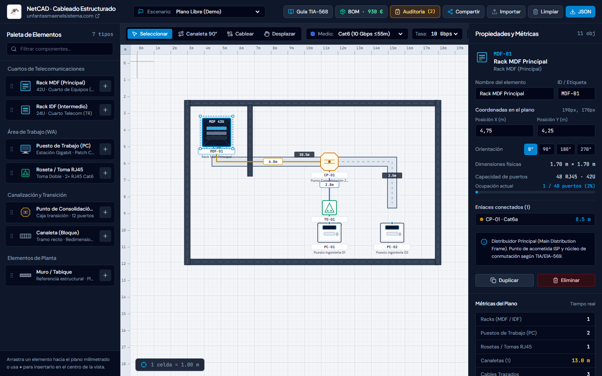
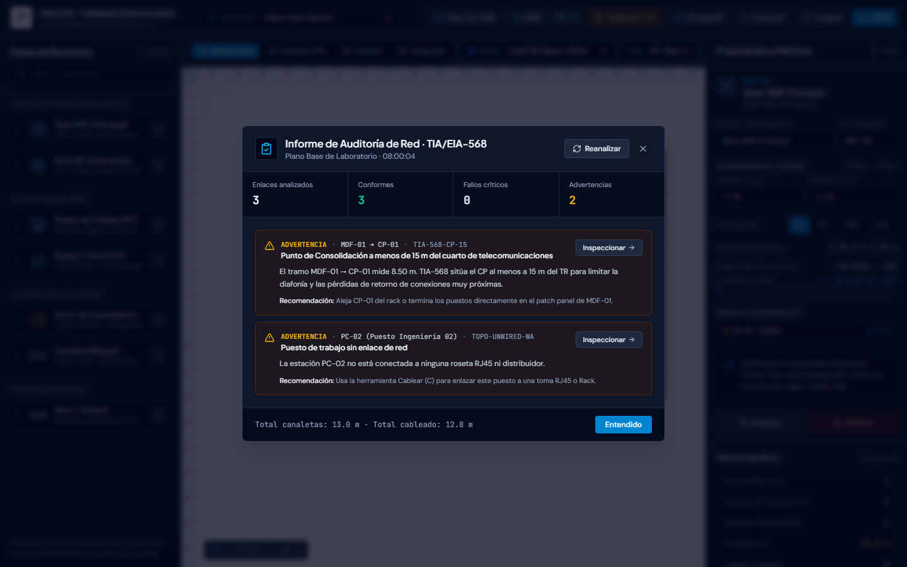
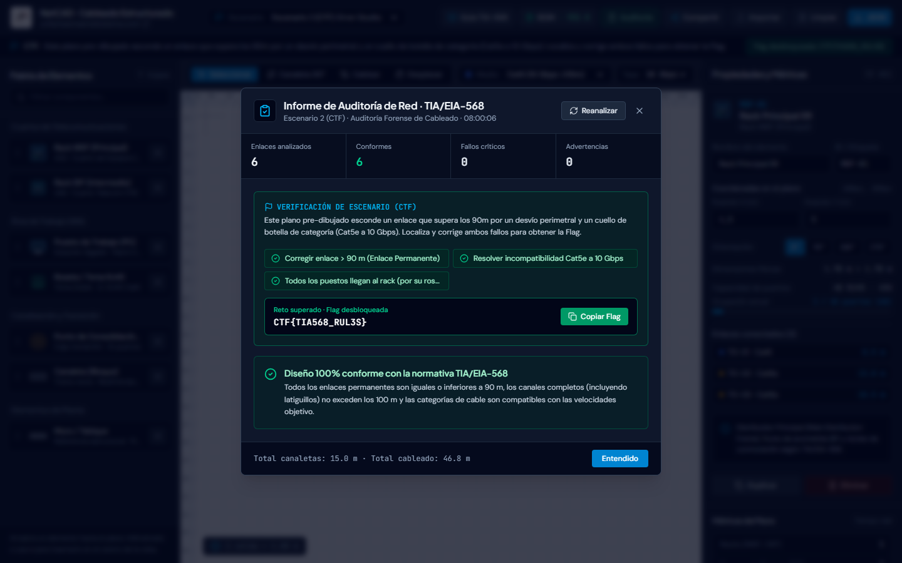
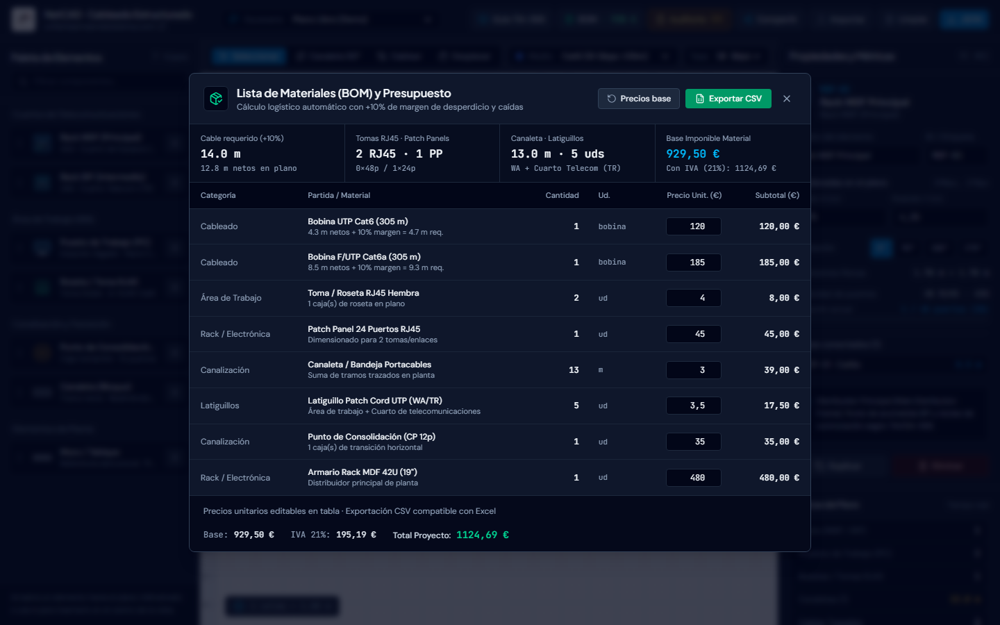
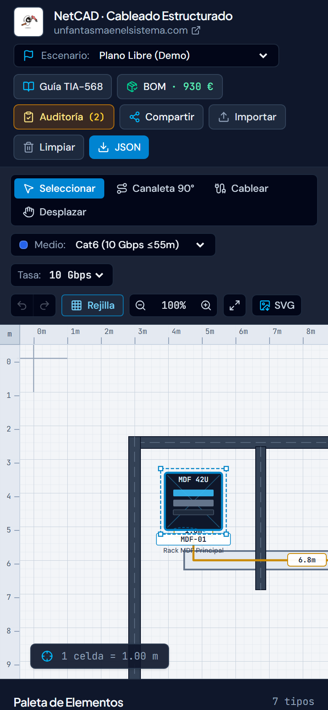

<div align="center">
  <a href="https://www.unfantasmaenelsistema.com/" target="_blank" rel="noopener noreferrer">
    
  </a>
  <h1>NetCAD · Simulador de Cableado Estructurado</h1>
  <p>
    <strong>Entorno CAD educativo 100% cliente (Zero-Backend) para diseño de planos de red, trazado ortogonal, auditoría normativa ANSI/TIA-568, presupuesto BOM y retos CTF.</strong>
  </p>
  <p>
    <a href="https://www.unfantasmaenelsistema.com/"></a>
    
    <a href="https://unfantasmaenelsistema.github.io/NetCAD/"></a>
    
  </p>
</div>

---

## Descripción General

**NetCAD · Cableado Estructurado** es un simulador interactivo de arquitectura de redes orientado a estudiantes de FP, certificaciones de redes, ingenieros de sistemas y academias técnicas. Permite diseñar planos de planta sobre una cuadrícula milimetrada real (`1 celda = 1.00 m`), dibujar canaletas ortogonales a 90°, tender enlaces de cobre o fibra óptica con ajuste magnético (*snap*), validar automáticamente el cumplimiento de la norma **ANSI/TIA-568** y generar una **Lista de Materiales (BOM)** exportable a CSV sin depender de ningún servidor.

Desarrollado para funcionar íntegramente en el navegador y desplegarse de forma estática en **GitHub Pages**.

**▶ Pruébalo ya:** https://unfantasmaenelsistema.github.io/NetCAD/

---

## Capturas de Pantalla

> Capturas reales de la aplicación (versión 2), tomadas sobre la compilación de producción.

### 1. Editor CAD de planta y trazado con *snap* a canaletas
> Paleta de elementos, plano milimetrado con reglas métricas, símbolos en planta, cables por categoría (`Cat5e`, `Cat6`, `Cat6a`, `OM3/OM4`) y panel de propiedades con la ocupación de puertos del rack.



### 2. Auditoría normativa TIA/EIA-568
> El plano de demostración coloca el punto de consolidación a 8,5 m del rack: la auditoría avisa de que TIA-568 lo quiere a 15 m o más y señala el puesto que se ha quedado sin cablear.



### 3. Reto CTF superado
> Al corregir los dos fallos ocultos del Escenario 2 se completa la lista de comprobación y aparece la flag.



### 4. Lista de materiales (BOM) y presupuesto
> Bobinas de 305 m con un 10 % de margen, patch panels de 24/48 puertos, rosetas, canaleta, latiguillos e IVA (21 %), con precios editables y exportación a CSV.



### 5. Versión móvil
> En pantallas estrechas el plano queda arriba y la paleta y las propiedades pasan debajo, sin desbordes laterales.



---

## Funcionalidades Principales

### Diseño CAD y Topología (Fase 1)
- **Paleta de Elementos**: Racks `MDF` (42U / 48 puertos) e `IDF` (24U / 24 puertos), Puestos de Trabajo (`PC`), Tomas/Rosetas `RJ45`, Puntos de Consolidación (`CP`), Canaletas y Muros estructurales.
- **Drag & Drop y Edición Precisa**: Arrastra componentes al lienzo con ajuste opcional a la rejilla, rota en pasos de 90°, redimensiona muros/canaletas e inspecciona coordenadas métricas `X/Y` y ocupación de puertos en el Rack.
- **Historial y Exportación Vectorial**: Deshacer / Rehacer (`Ctrl+Z` / `Ctrl+Y`) y exportación del plano completo a **SVG vectorial**, además de guardar/cargar topologías en **JSON**.

### Motor de Trazado y Categorías de Medios (Fase 2)
- **Herramienta de Canaletas 90° (`T`)**: Dibujo poligonal estrictamente ortogonal con acotación en tiempo real por segmento.
- **Tendido Inteligente con Snap (`C`)**: Al acercar el cursor a una canaleta existente, el cable se acopla magnéticamente (`Snap`) siguiendo automáticamente las esquinas de la bandeja.
- **Tipos de Medios Diferenciados**:
  - `Cat5e` (Gris · hasta 1 Gbps)
  - `Cat6` (Azul · 10 Gbps hasta 55 m / 1 Gbps hasta 90 m)
  - `Cat6a` (Amarillo/Ámbar · 10 Gbps hasta 90 m de enlace permanente / 100 m canal)
  - `Fibra Óptica OM3/OM4` (Aguamarina · Backbone 10 Gbps hasta 300–400 m)

### Motor Educativo ANSI/TIA-568 y Guía Técnica (Fase 3 + Mejoras)
- **Regla de los 90 Metros (Enlace Permanente)**: Cualquier enlace horizontal en cobre que supere los `90.0 m` parpadea en rojo en el plano y muestra la alerta `¡Violación de Norma: Enlace Permanente > 90m!`. Si el enlace pasa por un **Punto de Consolidación**, se suma el recorrido completo `Rack → CP → Toma` (regla `TIA-568-PERM-90`): dos tramos de 60 m y 40 m ya no pasan por separado.
- **Distancia mínima del Punto de Consolidación**: El CP debe estar al menos a `15 m` del cuarto de telecomunicaciones; si no, la auditoría avisa (`TIA-568-CP-15`).
- **Cálculo de Canal Completo (≤ 100 m)**: Campos configurables para latiguillos (*Patch Cords*) en Área de Trabajo (`WA`) y Cuarto de Telecomunicaciones (`TR`), comprobando `Enlace + WA + TR ≤ 100 m`.
- **Alertas de Velocidad y Atenuación**: Detecta intentos de `10GBASE-T` sobre `Cat5e` y atenuación de `Cat6` a `10 Gbps` por encima de `55 m`.
- **Guía Técnica Integrada (`Guía TIA-568`)**: Diagrama visual Enlace Permanente vs. Canal Completo, tabla interactiva de código de colores **T568A / T568B** (pines 1–8) y referencia rápida de categorías y atajos.

### Logística y Presupuesto BOM (Fase 4)
- Conteo dinámico de bobinas de `305 m` o metros de fibra con **+10% de margen de desperdicio y caídas**, rosetas RJ45, Patch Panels de 24/48 puertos, metros de canaleta y latiguillos.
- Precios unitarios editables en tiempo real con desglose de Base Imponible, IVA (21%) y Total.
- Exportación directa a **CSV** (`UTF-8` con BOM para Excel) generada 100% en cliente mediante `Blob`.

### Modo Academia (CTF) y Persistencia sin Backend (Fase 5)
- **Persistencia en URL (`?map=base64...`)**: Cada cambio serializa la topología en JSON codificado en Base64 UTF-8 dentro de la barra de direcciones para compartir ejercicios o entregar soluciones con un clic.
- **4 Escenarios Integrados**:
  1. **Plano Libre (Demo)**: Oficina con rack MDF, punto de consolidación, roseta y dos puestos, para diseñar libremente.
  2. **Escenario 1 (Fácil)**: Conectar los 5 PCs al rack `MDF-01` sin errores TIA-568 y con la base imponible ≤ 1.000 €.
  3. **Escenario 2 (CTF)**: Plano pre-dibujado con un fallo normativo y otro de categoría ocultos; la Flag aparece al corregir ambos.
  4. **Escenario 3 (CTF Backbone)**: Ala remota a más de 100 m: hay que instalar un Rack `IDF`, unirlo al `MDF-01` con fibra `OM3/OM4` y llevar cada puesto al MDF o al IDF.
- **Comprobaciones de verdad**: Un puesto solo cuenta si llega al rack siguiendo los cables (directamente o por rosetas y puntos de consolidación); unir PCs entre sí no vale. En el Escenario 3 la fibra tiene que ir de `MDF` a `IDF`: un tramo de fibra cualquiera no es un troncal.

<details>
<summary><strong>Soluciones y Flags CTF (solo para docentes)</strong></summary>

- **Escenario 1 (Fácil)**: `CTF{5PC_BUDG3T_0K}`: conectar los 5 PCs al `MDF-01` por la canaleta central, sin errores ni advertencias, con la base imponible ≤ 1.000 €.
- **Escenario 2 (CTF Error Oculto)**: `CTF{TIA568_RUL3S}`: acortar el enlace de `TO-03` (el desvío perimetral supera los 90 m de enlace permanente) y cambiar a `Cat6a` el enlace `10G` de `TO-02`, que va en `Cat5e`.
- **Escenario 3 (CTF Backbone IDF)**: `CTF{IDF_B4CKB0N3_10G}`: instalar un `IDF` en el Ala Este, unirlo al `MDF-01` con **fibra OM3/OM4** y conectar los puestos lejanos al `IDF` y los cercanos al `MDF`, sin errores ni advertencias.

</details>

---

## Atajos de Teclado CAD

| Atajo | Acción |
| :--- | :--- |
| `V` | Herramienta Seleccionar / Mover |
| `T` | Dibujar Canaleta ortogonal 90° |
| `C` | Trazar Cable UTP / Fibra |
| `H` o `Espacio` | Desplazar lienzo (*Pan*) |
| `Ctrl + Z` / `Ctrl + Y` | Deshacer / Rehacer cambios |
| `Ctrl + D` | Duplicar elemento seleccionado |
| `Supr` / `Backspace` | Eliminar nodo, canaleta o cable seleccionado |
| `Esc` | Cancelar trazo activo o cerrar modal |

---

## Instalación Local y Desarrollo

Requisitos previos: **[Bun](https://bun.sh/)** (el proyecto usa `bun.lock`).

```bash
# 1. Clonar el repositorio
git clone https://github.com/unfantasmaenelsistema/NetCAD.git
cd NetCAD

# 2. Instalar dependencias
bun install

# 3. Iniciar servidor de desarrollo (http://localhost:3000)
bun run dev

# 4. Verificar tipos TypeScript y compilar para producción (carpeta dist/)
bun run lint
bun run build
```

---

## Despliegue en GitHub Pages

El proyecto usa `base: './'` en `vite.config.ts` y el flujo `.github/workflows/deploy.yml`: cada `push` a `main` instala con Bun (`bun install --frozen-lockfile`), comprueba los tipos, compila `dist/` y lo publica en https://unfantasmaenelsistema.github.io/NetCAD/ (en **Settings → Pages**, la fuente es **GitHub Actions**).

---

## Novedades de la versión 2

- **Despliegue reparado**: el workflow usaba la caché de npm sin `package-lock.json` y fallaba siempre; ahora instala con Bun y publica en GitHub Pages.
- **Regla de los 90 m a través del Punto de Consolidación**: se suma `Rack → CP → Toma` en vez de medir cada tramo por separado.
- **Aviso de CP a menos de 15 m** del cuarto de telecomunicaciones.
- **Retos sin atajos**: los escenarios comprueban que cada puesto llega de verdad al rack (no vale encadenar PCs) y el Escenario 3 exige el troncal de fibra `MDF ↔ IDF`.
- **Versión móvil**: cabecera y barra de herramientas se reparten en varias filas y el plano queda arriba, sin desbordes.
- **Limpieza**: fuera las dependencias y ficheros que no se usaban, y las capturas son reales (PNG).
- Corregidos en este README la flag y el presupuesto del Escenario 1, y las URL de ejemplo.
- **Escenario 2 sin atajo**: el desvío perimetral de `TO-03` medía 82,5 m y no saltaba la regla de los 90 m, así que bastaba con corregir el Cat5e. Ahora mide 92,5 m (canal 97,5 m) y cada punto de la lista de comprobación se marca con su propio fallo.

---

## Autoría y Licencia

Proyecto creado para la academia online [**Un Fantasma en el Sistema**](https://www.unfantasmaenelsistema.com/).  
Distribuido bajo licencia **MIT** — consulta el archivo [`LICENSE`](LICENSE) para más información.
